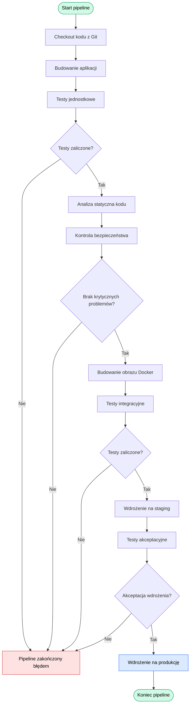

# Pipeline CI/CD w Jenkinsie – diagram Mermaid

## Opis diagramu

Diagram przedstawia automatyczny proces CI/CD
dla aplikacji webowej z wykorzystaniem Jenkinsa.

Pipeline rozpoczyna się od pobrania kodu
i kończy wdrożeniem aplikacji na produkcję.
