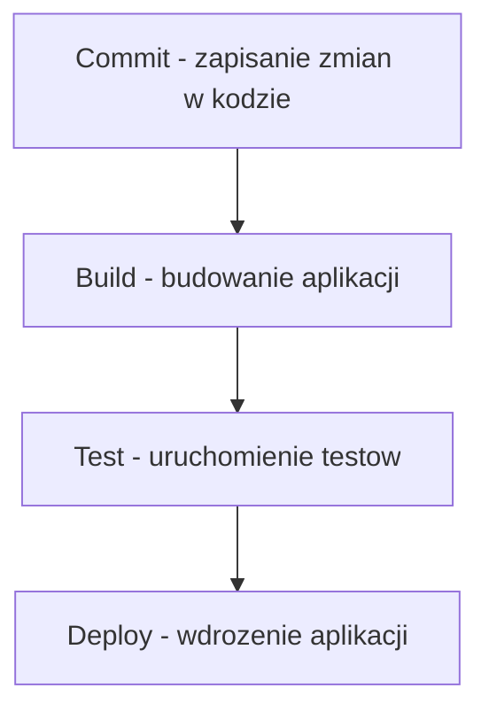

# Zadanie 6 – Podstawowy diagram przepływu CI/CD

## Prompt

Stwórz prosty diagram Mermaid pokazujący proces CI/CD:
commit → build → test → deploy.

## Kod Mermaid



## Opis wygenerowanego diagramu

Diagram przedstawia podstawowy proces CI/CD składający się z czterech etapów:

1. **Commit** – programista zapisuje zmiany w repozytorium.
2. **Build** – system buduje aplikację.
3. **Test** – automatycznie uruchamiane są testy sprawdzające poprawność kodu.
4. **Deploy** – aplikacja zostaje wdrożona na serwerze.

## Wizualizacja diagramu

```text
+----------------------+
| COMMIT               |
| Zapisanie zmian      |
+----------------------+
          |
          v
+----------------------+
| BUILD                |
| Budowanie aplikacji  |
+----------------------+
          |
          v
+----------------------+
| TEST                 |
| Testowanie aplikacji |
+----------------------+
          |
          v
+----------------------+
| DEPLOY               |
| Wdrożenie aplikacji  |
+----------------------+
```

## Wnioski

Diagram przedstawia prosty i czytelny proces CI/CD. Każdy etap
następuje po poprzednim. Dzięki automatyzacji budowania, testowania
i wdrażania aplikacji można szybciej dostarczać zmiany oraz ograniczyć
ryzyko błędów.

Mermaid pozwala tworzyć diagramy za pomocą tekstowego kodu,
co ułatwia ich edycję i przechowywanie w dokumentacji projektu.